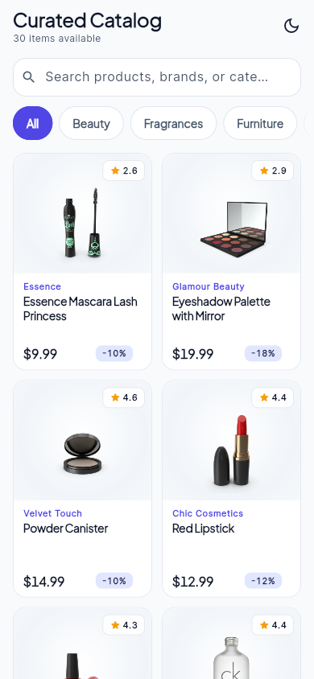
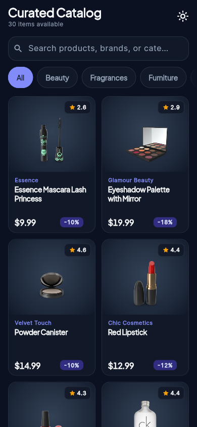
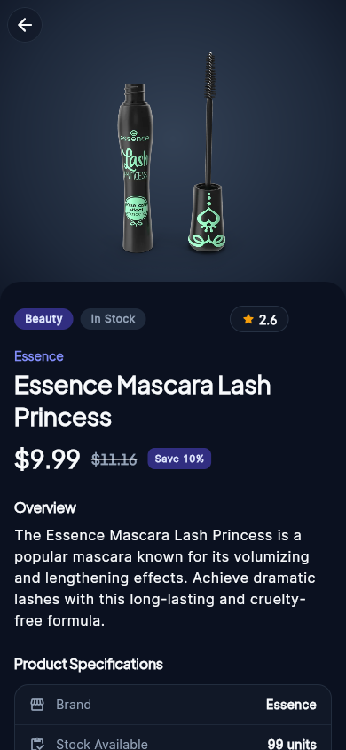

# Curated Catalog — Flutter Product Catalog

A production-grade Flutter Product Catalog application architected with Feature-First Clean Architecture, strict static analysis, defensive security hygiene, and a Material 3 design system.

| Light Catalog | Dark Catalog | Product Details |
| :---: | :---: | :---: |
|  |  |  |

---

## Key Engineering & Security Decisions

- **Sealed Error Boundary (`CatalogResult<T>` & `Failure`):** Repository calls catch network, timeout, HTTP status, and schema errors and return a Dart 3 sealed `CatalogResult<T>` (`CatalogSuccess` / `CatalogFailure`) carrying domain `Failure` subtypes (`NetworkFailure`, `TimeoutFailure`, `ServerFailure`, `DataParsingFailure`), guaranteeing raw exceptions and stack traces never leak to the UI.
- **Race-Condition-Free Concurrency (`EventTransformer`):** Search input uses a native `dart:async` `_debounceRestartableSearch` (`300ms`) transformer whose timer is explicitly cancelled on `CatalogFiltersReset` and `close()`, while load and category events run on a `_restartable` latest-request-wins stream to eliminate stale emissions during rapid typing and filter switches.
- **HTTPS URI Construction & Defensive JSON Parsing:** Endpoints and query parameters are constructed strictly via `Uri.https(...)` over a configurable `API_BASE_URL` with an explicit `10s` timeout. `ProductModel.fromJson` validates required fields and normalizes numeric/collection types without `dynamic` or unsafe casts.
- **1.3x Accessibility Font-Scale Verification:** Card aspect ratios, chip strip heights, and `SliverAppBar` toolbar heights scale dynamically with `MediaQuery.textScalerOf(context)`, backed by widget audit tests asserting zero `RenderFlex` overflows across Loading, Success, Empty, Error, and Product Details views at `1.3x` text scale (`390x844`).

---

## Architecture

The project follows a **Feature-First Clean Architecture** layout separating platform/design primitives (`lib/core/`) from feature layers (`lib/features/catalog/`):

```text
lib/
├── main.dart                     # Composition root
├── app.dart                      # MaterialApp, ThemeMode & BlocProviders
├── core/
│   ├── constants/                # HTTPS API config & input constraints
│   ├── error/                    # Low-level exceptions & sealed domain Failures
│   ├── network/                  # Defensive ApiClient (timeouts, typed JSON)
│   ├── theme/                    # Material 3 light/dark themes, spacing & radius tokens
│   └── utils/                    # Search query sanitization & HTTPS URL validation
└── features/
    └── catalog/
        ├── domain/               # Immutable Product entity & CatalogRepository contract
        ├── data/                 # Defensive DTOs, remote data source & repository impl
        └── presentation/         # CatalogBloc, pages (Catalog & Details), modular widgets
```

- **Strict Layer Boundaries:** UI widgets contain zero HTTP calls, JSON parsing, or filtering logic.
- **Strict Typing:** Configured in `analysis_options.yaml` with `strict-casts: true`, `strict-inference: true`, `strict-raw-types: true`, and zero `dynamic` usage.

---

## State Management

- **Catalog State (`CatalogBloc`):** Built with `flutter_bloc` and `Equatable` immutable states (`CatalogStatus.initial`, `loading`, `success`, `failure`).
- **Concurrency & Debouncing:** Search queries are debounced (`300ms`) with a latest-request-wins (`_debounceRestartableSearch`) event transformer whose timer is cancelled on reset, while load and category events cancel stale in-flight work (`_restartable`) to prevent race conditions.
- **Theme State (`ThemeCubit`):** Defaults to `ThemeMode.system` and supports instant AppBar Light/Dark switching.

---

## Security & Resilience Practices

- **HTTPS-Only URI Construction:** Base URL defaults to `https://dummyjson.com` and is overridable via `--dart-define=API_BASE_URL=...`. All endpoints and query parameters are constructed via `Uri.https(...)`—never string concatenation.
- **Explicit Timeouts & Transport Integrity:** `ApiClient` enforces a `10s` timeout and never overrides SSL/TLS certificate validation.
- **Defensive Parsing & Domain Errors:** `ProductModel.fromJson` validates required fields (`id`, `title`, `price`) and safely parses optional/numeric values without unsafe casts. Exceptions are caught in `CatalogRepositoryImpl` and mapped to sealed domain `Failure` classes (`NetworkFailure`, `TimeoutFailure`, `ServerFailure`, `DataParsingFailure`) so raw exception strings or stack traces never leak to the UI.
- **Input & Media Sanitization:** `InputSanitizer.sanitizeSearchQuery` trims, normalizes whitespace, and length-caps queries to `100` characters. `UrlValidator.isValidHttpsUrl` verifies `https://` URLs before rendering images, paired with graceful `errorBuilder` fallbacks.
- **Zero Sensitive Logs:** No `print()` calls; diagnostic logs are strictly guarded by `if (kDebugMode)`.

---

## UI/UX Design System

- **Tokens (`lib/core/theme/`):**
  - `AppSpacing`: `4, 8, 12, 16, 24, 32`
  - `AppRadius`: `sm: 8`, `md: 12`, `lg: 16`, `xl: 24`
  - **Palette:** Neutral slate surfaces paired with Deep Indigo (`#4F46E5`) primary accent across Light and Dark Material 3 `ColorScheme`s.
- **Typography (`google_fonts`):**
  - `Plus Jakarta Sans` (semi-bold/bold, `-0.3` letter spacing) for titles, headers, and prices.
  - `Inter` for descriptions and metadata, with `FontFeature.tabularFigures()` on prices and ratings.
- **Crafted Interactions & Non-Happy States:**
  - `ProductCard` with `1px` hairline borders, `1.15` aspect-ratio image frames, and `Hero` transition into an expandable `SliverAppBar` on `ProductDetailsPage` (`250ms` `Curves.easeOutCubic` content entrance).
  - Pulsing skeleton grid (`ProductShimmerGrid`) during `Loading`, `CatalogEmptyState` with **Reset Filters** (`FilledButton.tonal`), and `CatalogErrorState` with **Try Again** (`FilledButton`).

---

## Test Suite (15 Passing Tests)

- **DTO & Defensive Parsing (`test/features/catalog/data/models/product_model_test.dart` — 5 tests):** Valid full payloads, integer-to-double numeric normalization, missing optional field defaults, range clamping, and `DataParsingException` guards for invalid `id`, `title`, and `price`.
- **State & Concurrency (`test/features/catalog/presentation/bloc/catalog_bloc_test.dart` — 7 tests):** Initial state, load success with sorted categories, load failure mapping, `300ms` search debouncing, `100`-character query capping, combined category + search filtering, and rapid search/category/reset race-condition safety.
- **UI & Accessibility Audits (`test/features/catalog/presentation/pages/catalog_audit_widget_test.dart` — 3 tests):** Zero `RenderFlex` overflow across Loading, Success, Empty, Error, and Product Details views at `1.3x` font scaling (`390x844`), offline error + retry recovery, and rapid typing with concurrent category switching.

---

## Setup, Analysis & Testing

```bash
# Install dependencies
flutter pub get

# Static analysis (0 warnings / 0 errors)
flutter analyze

# Run all 15 unit, bloc, and widget tests
flutter test

# Run on Chrome (or mobile emulator)
flutter run -d chrome
```
